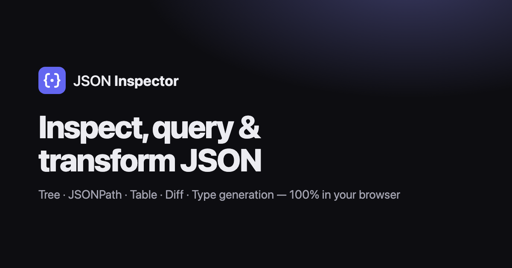

# JSON Inspector

A fast, private JSON viewer and editor that runs entirely in the browser. Open, explore, query, edit, diff and convert JSON. Nothing is uploaded, and it works offline.



## Features

**Views**

| View | What it does |
|------|--------------|
| **Tree** | Virtualized tree that opens multi-megabyte files smoothly. Full keyboard navigation, context menu, inline editing, undo/redo |
| **Raw** | Syntax-highlighted source with line numbers. Choose 2 spaces, 4 spaces, tabs or minified. Built-in editor with live validation |
| **Table** | Arrays of records as a sortable, filterable grid. Can flatten nested objects. Export to CSV or copy as TSV for spreadsheets |
| **Diff** | Structural comparison that ignores key order and formatting. Smart array matching (LCS) detects inserted and removed items |
| **Generate** | TypeScript interfaces, Zod schemas, JSON Schema (2020-12), Go structs and Python `TypedDict`s, plus conversion to YAML and CSV |

**Search and query**
- Text search over **all** keys and values, including collapsed nodes, with case-sensitive, regex and *filter* (show only matches) modes.
- JSONPath queries: type an expression starting with `$` into the search box.

**Inspector**
- The selected node's path in four formats: JSONPath, JSON Pointer (RFC 6901), bracket notation and JavaScript accessor.
- Detects and explains:
  - dates and Unix timestamps
  - URLs
  - colors
  - **JWTs** (decodes the header and payload, shows expiry)
  - JSON embedded in strings (one click expands it into the tree)
- Edit a value and change its type. You can also rename, duplicate, add and delete nodes.

**Input**
- Paste, open a file, drag and drop, fetch a URL, or use `?url=https://…`.
- **Auto-repair**: comments, trailing commas, single quotes, unquoted keys, `True/False/None`, JSONP wrappers and `const x = {…}` are fixed automatically.
- **JSON Lines / NDJSON** is detected and loaded as an array.
- Parse errors show the line, the column, a code excerpt with a caret, and a hint.
- Warns when large integers lose precision.

**Other**
- **Share links**: the document is deflate-compressed into the URL fragment (`#z=…`). Fragments are never sent to a server.
- Recent documents and your edits are autosaved locally in IndexedDB.
- Light, dark and system themes. Responsive down to phone sizes. Installable as a PWA that works offline and can open `.json` files.

## Keyboard shortcuts

| Key | Action |
|-----|--------|
| `⌘/Ctrl O` | Open file |
| `⌘/Ctrl S` | Download JSON |
| `⌘/Ctrl Z`, `⌘/Ctrl ⇧ Z` | Undo / redo |
| `1`–`5` | Tree / Raw / Table / Diff / Generate |
| `/` or `⌘/Ctrl F` | Focus search (`Enter` / `⇧Enter` for next / previous match) |
| `↑ ↓ ← →`, `Home`, `End`, `PgUp`, `PgDn` | Navigate the tree |
| `Enter` | Expand/collapse, or edit a value |
| `*` | Expand the selected subtree |
| `E` / `C` | Expand all / collapse all |
| `F2` / `Del` | Edit / delete the selected node |
| `⌘/Ctrl C` (in the tree) | Copy the selected value |
| `⌘/Ctrl ↵` | Inspect, apply or compare (depending on context) |
| `?` | Show all shortcuts |

## JSONPath

| Expression | Meaning |
|------------|---------|
| `$.store.book[*].author` | Every book's author |
| `$..price` | Every `price`, at any depth |
| `$..book[2]`, `$..book[-1]` | Third book / last book |
| `$..book[0,1]`, `$..book[:2]`, `$..book[::-1]` | Unions, slices, reverse |
| `$['odd key']["a/b"]` | Quoted names |
| `$..book[?(@.isbn)]` | Books that have an `isbn` |
| `$..book[?(@.price < 10 && @.category == 'fiction')]` | Comparisons with `&&`, `\|\|`, `!` |
| `$..book[?(@.author =~ /tolkien/i)]` | Regex match |
| `$..book[?(length(@.tags) > 2)]` | `length()` of an array, string or object |

## Project structure

```
public/                 ← the deployed site (no build step)
├── index.html
├── css/app.css         design tokens, light/dark themes, layout
├── js/
│   ├── main.js         app controller: landing, views, search UI, shortcuts, boot
│   ├── state.js        document state, undo/redo, event bus
│   ├── tree.js         virtualized tree
│   ├── inspector.js    inspector panel and value detectors
│   ├── actions.js      node operations (edit, rename, add, delete, …)
│   ├── path.js         path formats and copy-on-write updates
│   ├── parse.js        strict parser with precise errors, plus a tolerant repairer
│   ├── jsonpath.js     JSONPath engine with filter expressions
│   ├── search.js       text, regex and JSONPath search
│   ├── diff.js         structural diff (LCS for arrays)
│   ├── generate.js     type inference, code generators, YAML and CSV
│   ├── share.js        compressed share links
│   ├── storage.js      recent documents (IndexedDB)
│   ├── ui.js           toasts, menus, dialogs, clipboard, downloads
│   └── views/          raw, table, diff and generate views
├── sw.js               offline support (network-first)
├── _headers            security headers and CSP for Cloudflare Pages
└── manifest.webmanifest
tests/                  unit and end-to-end tests that run in headless Chrome
wrangler.toml           Cloudflare Pages configuration
```

The app uses plain ES modules, with no framework, no bundler and no runtime dependencies.

## Run locally

```bash
python3 -m http.server 8000 --directory public
# → http://localhost:8000
```

ES modules need a web server, so opening `index.html` as a file won't work. `npx serve public` works too.

## Tests

```bash
tests/run.sh
```

This runs the unit tests (`tests/index.html`) and the end-to-end tests (`tests/e2e.html`) in headless Chrome. The e2e tests drive the real UI: parsing and repair, tree navigation, search, editing, undo, the table, raw, diff and generate views, share links, and a 60,000-record document. GitHub Actions runs the same tests on every push (`.github/workflows/ci.yml`).

## Deploy to Cloudflare Pages

There are two ways. **Option A** redeploys automatically on every push.

**Option A — Git integration (recommended)**
1. Push this repository to GitHub.
2. In the Cloudflare dashboard, go to **Workers & Pages → Create → Pages → Connect to Git**, then pick the repository.
3. Build settings:
   - Framework preset: **None**
   - Build command: *(leave empty)*
   - Build output directory: **`public`**
4. Click **Save and Deploy**. Every push to `main` deploys to production, and every other branch gets a preview URL.

**Option B — Wrangler CLI** (requires Node.js)
```bash
npx wrangler login
npx wrangler pages deploy        # reads wrangler.toml → deploys ./public
```

**Option C — Direct upload:** in **Workers & Pages → Create → Pages → Upload assets**, drag in the `public` folder.

After the first deploy, you can add a custom domain under the project's **Custom domains** tab.

## Privacy

All parsing and processing happens in your browser. There is no backend, no analytics and no tracking. Data leaves the page only in these cases:
- you fetch a URL yourself (the browser requests it directly), or
- you create a share link (the data is inside the link itself).

## License

MIT
